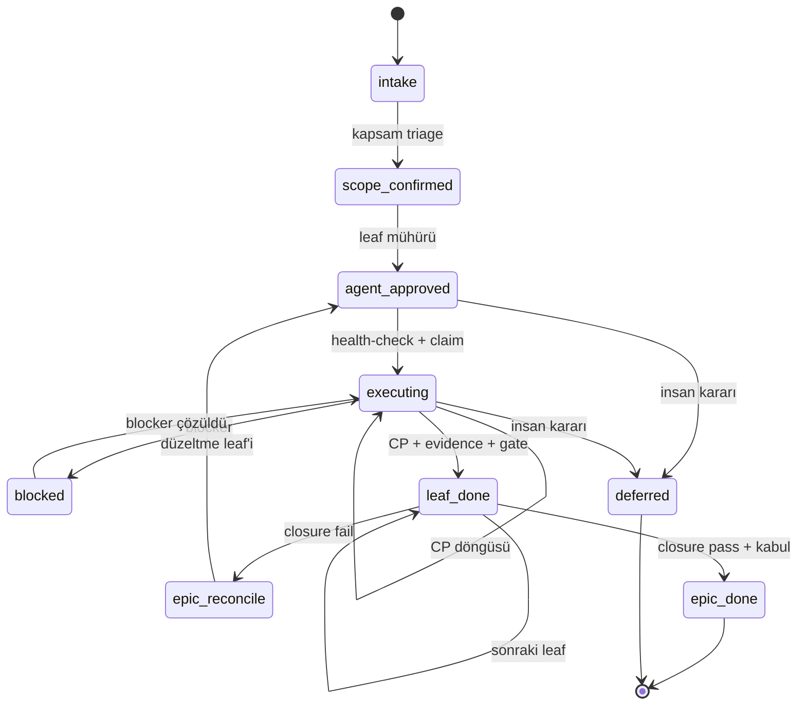

# Delivery contract — v2.28

Bu dosya delivery'nin **tek durum makinesi**dir. Agent, path ve risk verisi
`registry.yaml`'da; artefakt şekilleri `schemas/` altında; uygulama
`scripts/doctor.sh` ile denetlenir.

Eski v1 yürütmesi arşivdedir (`archive/v1.7/`). Yeni runtime yalnızca `delivery/`,
`skills/`, `schemas/` ve `scripts/` üzerinden çalışır.

## Artefaktlar

| Artefakt | Taşıyıcı | Şema | Üreten | Onaylayan |
|----------|----------|------|--------|-----------|
| Epic | GitHub issue + KEEP tablosu | `schemas/epic.schema.json` | owner + orchestrator | insan (`scope-confirmed`) |
| Leaf seal | issue body içinde `demir-kit` YAML bloğu | `schemas/leaf.schema.json` | seal | orchestrator (`agent-approved`) |
| Evidence | issue comment | `schemas/evidence.schema.json` | coordinator + documenter | gate sonuçları |
| Closure | issue comment | `schemas/closure.schema.json` | documenter | orchestrator + insan |
| Ecosystem | repo kökü `ecosystem.yaml` | — | devops | health-check |
| Capability registry | `delivery/capabilities/registry.yaml` + `role-matrix.yaml` | `capability.schema.json` | architect | doctor |
| Agent variant | `delivery/agents/<rol>/agent.yaml` | `agent.schema.json` | architect | doctor |
| Project capabilities | `.kit/capabilities.yaml` | — | adapt | doctor --product |

## Durum makinesi



`epic_reconcile` ve `epic_done` epic seviyesindedir; leaf etiketleriyle karışmaz.

## Geçişler

| # | From | To | Kim | Guard | Kanıt | Etiket |
|---|------|----|-----|-------|-------|--------|
| T1 | `intake` | `scope-confirmed` | orchestrator | KEEP/DEFER/CUT tablosu + child listesi | epic comment | `+scope-confirmed` |
| T2 | `scope-confirmed` | `agent-approved` | seal | leaf şeması geçerli, AC ↔ tests_plan tam | issue body YAML | `+agent-approved` |
| T3 | `agent-approved` | `executing` | coordinator | health-check `ready`, bağımlılıklar kapalı, claim | run comment | `+executing` |
| T4 | `executing` | `leaf-done` | coordinator | tüm CP evidence + risk gate'leri | evidence comment'leri | `+leaf-done -executing` |
| T5 | `executing` | `blocked` | coordinator | `policies/escalation.md` maddesi | blocker comment | `+blocked` |
| T6 | `blocked` | `executing` | coordinator / insan | blocker çözüldü | unblock comment | `-blocked` |
| T7 | `agent-approved` / `executing` | `deferred` | insan | defer issue linki | karar comment | `-executing +deferred` |
| T8 | tüm leaf'ler `leaf-done`/`deferred` | closure | orchestrator | `runbooks/epic-closure.md` | closure report | — / `+epic-reconcile` |
| T9 | closure `pass` | `epic-done` | insan | rapor `pass` + tüm child `leaf-done/deferred` + insan-authored `demir-kit-accept` | human comment | `+epic-done` |

Kurallar:

- T2–T6 otomatiktir; insan sormaz. Yalnız T7, T9 ve risk yüksek leaf QA insan ister.
- T4, evidence şeması geçerli değilse **imkânsızdır** (`doctor.sh --issue N`).
- T9, closure `status: pass` değilse, açık child varsa veya kabul bloğu insan
  tarafından yazılmadıysa yasaktır; "epic bitti" demek contract ihlalidir.
- Her geçiş idempotenttir: aynı hedef durumda tekrar çalıştırmak no-op'tur.

## Etiket sözlüğü

Kanonik set `templates/github-labels.json` ile birebir aynıdır.

| Etiket | Anlam | Kim koyar |
|--------|-------|-----------|
| `intake` | Taslak; kapsam kilitli değil | owner |
| `scope-confirmed` | Epic kapsamı kilitli | orchestrator |
| `agent-approved` | Leaf mühürlü; yürütülebilir | seal |
| `executing` | Claim edildi, CP döngüsü açık | coordinator |
| `blocked` | Dış bağımlılık / bütçe aşımı | coordinator |
| `deferred` | Bilinçli ertelendi, issue linki var | insan |
| `leaf-done` | Leaf gate + evidence tamam | coordinator |
| `human-qa` | İnsan kararı bekliyor | coordinator |
| `epic-reconcile` | Closure gap'i var | orchestrator |
| `epic-done` | Closure pass + insan kabulü | insan |
| `architect-revise` | Architect bulgusu açık | coordinator |
| `commercial-revise` | Commercial bulgusu açık | coordinator |
| `discovery-approved` | Keşif yönü onaylı | insan |
| `architecture-baseline-done` | Mimari baseline kabul | insan |
| `commercial-baseline-done` | Ticari baseline kabul | insan |
| `feasibility-hold` | Fizibilite kararı bekliyor | orchestrator |
| `learning` | Retro/öğrenme kaydı | documenter |

Emekli: `done`, `packaging`, `discovery-done`. Yeni issue'larda kullanılmaz.

## Risk modeli (insan kapısı = C)

| Seviye | Kapsam | Zorunlu gate'ler | İnsan |
|--------|--------|------------------|-------|
| `low` | docs, copy, test, izole UI, config | behavior + 1 reviewer + evidence | yok (spot-check) |
| `medium` | feature UI, API sözleşmesi, geri alınabilir migration | behavior + 1 adversarial + UI (UI ise) | bütçe aşılırsa |
| `high` | auth, ödeme, izin, veri göçü, prod infra, güvenlik | behavior + architect + 2 adversarial + platform | leaf QA |
| `critical` | store submit, prod deploy, fiyat, yıkıcı migration | high + ikinci insan | her zaman |

`registry.yaml` `risk.auto_escalate` glob'larından biri diff'e değerse seviye
otomatik yükselir; agent düşüremez. Ayrıntı: `policies/quality-gates.md`.

## Definition of done

- **CP:** behavior komutu exit 0 + riskin istediği reviewer'lar `approved` +
  insan kapısı gerekiyorsa `reviews.human`/`human_second` `approved` +
  `package_version: 2` ise doğrulanabilir `verification` + evidence comment.
- **Leaf:** tüm CP'ler + her AC en az bir test case ile kapsanmış + açık bulgu yok +
  risk `high`/`critical` ise insan QA + `leaf-done`.
- **Epic:** tüm child'lar `leaf-done` veya `deferred` + closure `pass` +
  `demir-kit-accept` insan kabulü + metrikler yazıldı + `epic-done`.

## Değişmezler

| # | Kural |
|---|-------|
| I1 | `agent-approved` olmadan uygulama kaynağı değişmez (`scripts/guard.sh`). |
| I2 | Evidence şeması dolmadan `leaf-done` yok. |
| I3 | Closure `pass` olmadan `epic-done` yok. |
| I4 | Uygulayan onaylayamaz; reviewer temiz context'te çalışır. |
| I5 | Reviewer'lar birbirinin çıktısını görmez. |
| I6 | `delivery/` içinden arşive runtime referansı verilmez (`doctor.sh --strict`). |
| I7 | Epic başına tek leaf yürür; ikinci leaf ancak `depends_on` ayrıksa. |
| I8 | Aynı duruma tekrar geçiş no-op; tamamlanan CP yeniden koşmaz. |
| I9 | Contract değişikliği VERSION + CHANGELOG + doctor yeşili ister. |
| I10 | İnsan kapısı yalnız: risk `high`/`critical` leaf, geri dönülemez işlem, epic kabul. **Kapsam: hedef projedeki ürün teslimatı** (bkz. Self-improvement lane). |
| I11 | Etiket geçişleri yalnız `scripts/transition.sh` ile yapılır; doğrudan etiket yazımı yasaktır. |
| I12 | Capability seviyesi kanıtla atanır; agent `expert` üstüne çıkamaz, `authority` insan/principal içindir. |
| I13 | `epic-done` yalnız insan-authored `demir-kit-accept` + kapalı child'larla; agent kendi kabulünü yazamaz. **Kapsam: ürün teslimatı.** Kit self-improvement lane'de kabul makine kapısıdır (`doctor --strict` + testler yeşil). |
| I14 | Proje öncelikleri (`kit.config.yaml product.priorities` + `policies/project-priorities.md`) bağlayıcıdır: design system varsa uyulur, mimari sınırlar korunur, plana sadık kalınır, kalite zemini düşmez; uydurma bilgi üretilmez. |

## Self-improvement lane (kit kendi kendini geliştirir)

Hedef projelerdeki deneyimler `learnings.py` ile beyne (bu repo) taşınır
(`delivery/fleet.yaml`). Bu şerit `I10`/`I13` insan kapılarından muaftır;
kabul **makine kapısıdır**: `doctor.sh --strict` + testler yeşilse kurallaşır.

- **Beyaz liste (otomatik):** yalnız *ekleme* sınıfı — risk glob, eval
  senaryosu, skill notu. `learnings.py --apply` yazar, VERSION + CHANGELOG
  bump edilir (I9).
- **Beyaz liste dışı (otomatik yazılmaz):** kural azaltma/silme, risk düşürme,
  kapı gevşetme ve kod değişikliği — `learning` issue olarak kit akışına düşer.
  Gerekçe: tek bir kirli öğrenim tüm filoyu zayıflatabilir; eklemek güvenli,
  çıkarmak değil.
- Her otomatik değişiklik `.orchestration/learnings/` altında iz bırakır.

## Yürütme

- Kuyruk, claim, resume ve bütçeler: `protocol/execution.md`
- Proje öncelikleri: `policies/project-priorities.md`
- Mühür: `protocol/seal.md`
- Hazırlık: `protocol/health-check.md`
- Kanıt: `protocol/evidence.md`
- Gate matrisi: `policies/quality-gates.md`
- Blocker: `policies/escalation.md`
- İnsan dili: `policies/human-communication.md`

## İlerleme güncellemesi

İş bir issue'ya bağlıysa timeline **issue yorumlarıdır**; ayrı dosya yok.
Anlamlı dönüm noktalarında kısa Türkçe yorum yazılır:

| An | İçerik |
|----|--------|
| T2 seal | ne mühürlendi, risk |
| T3 claim | kim başladı, ilk adım |
| CP / review sonu | ne oldu, karar veya sorun |
| T4 leaf-done | ne bitti, sırada ne var |
| T8 closure | detaylı iş raporu (`report.py`) + kısa onay notu |

Format: `## İlerleme — …`; **Kim / Ne oldu / Karar / Sorun / Sırada / Onay**.
En fazla ~6 satır; teknik ID ana metinde yok. Onay gerekiyorsa `human-qa`.

```bash
python3 delivery/scripts/update.py --issue N --who developer --what "…" --next "…"
```

Onay isteniyorsa `--approval yes --ask "…"`. Issue yoksa komut stdout'a yazar;
sohbet sonunda aynı özet verilir.

## Denetim

```bash
./delivery/scripts/doctor.sh            # tüm statik kontroller
./delivery/scripts/doctor.sh --strict   # uyarılar da hata
./delivery/scripts/doctor.sh --issue 12 # seal + evidence tutarlılığı
```
