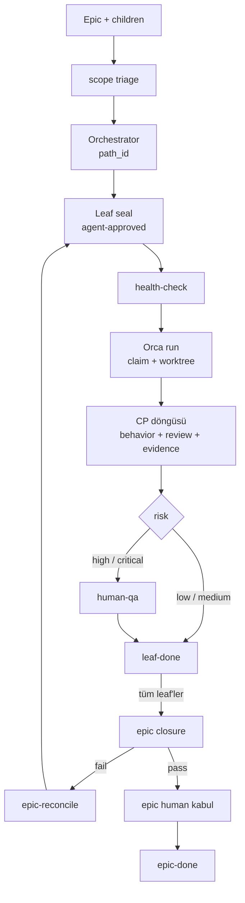

# Delivery flow — v2.3

Sözleşme: [CONTRACT.md](CONTRACT.md). Etiketler orada tanımlı.

## Ana akış

## Etiketler

| Etiket | Anlam |
|--------|-------|
| `scope-confirmed` | Epic kapsamı kilitli |
| `agent-approved` | Leaf mühürlü, yürütülebilir |
| `executing` | Claim edildi, CP döngüsü açık |
| `blocked` | Blocker / bütçe aşımı |
| `deferred` | Bilinçli ertelendi |
| `leaf-done` | Leaf gate + evidence tamam |
| `human-qa` | İnsan kararı bekliyor |
| `epic-reconcile` | Closure gap'i var |
| `epic-done` | Closure pass + kabul |

## Otonomi

- Soru yok: `scope-confirmed` sonrası plan, `agent-approved` sonrası yürütme,
  evidence sonrası sonraki CP, low/medium leaf kapanışı, closure.
- İnsan: risk `high`/`critical` leaf, geri dönülemez işlem, bütçe aşımı,
  belirsiz AC, epic kabulü.

## Dosyalar

- Protokol: [protocol/execution.md](protocol/execution.md)
- Gate matrisi: [policies/quality-gates.md](policies/quality-gates.md)
- Blocker: [policies/escalation.md](policies/escalation.md)
- İnsan dili: [policies/human-communication.md](policies/human-communication.md)
- Closure: [runbooks/epic-closure.md](runbooks/epic-closure.md)
